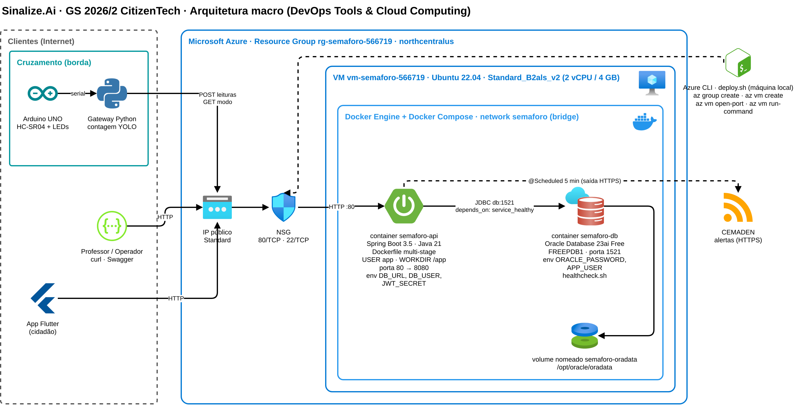

# Sinalize.Ai · DevOps Tools & Cloud Computing

Global Solution 2026/2 · CitizenTech · Turma 2TDSPR

| Integrante | RM |
|---|---|
| Ruan Lima da Silva | 566719 |
| Julia Valerio Guimarães da Silva | 568275 |
| Rhayssa Graziano Bernardes e Rocha Ferreira | 567549 |

**Solução:** semáforos que mudam de modo em enchentes (El Niño). O sensor de nível de água do cruzamento envia leituras; acima do limite, o cruzamento entra em `ATENCAO` (amarelo piscante). Alertas da Defesa Civil/CEMADEN levam a `EVACUACAO` (onda verde até o abrigo). O cidadão consulta o modo pelo app.

Esta entrega roda a **API Java (Spring Boot 3.5 / Java 21)** e o **Oracle Database 23ai Free** em dois containers Docker Compose numa VM Azure provisionada por Azure CLI.

## Arquitetura macro



Fonte editável: [`docs/arquitetura.drawio`](docs/arquitetura.drawio) (draw.io) · vetor: [`docs/arquitetura.svg`](docs/arquitetura.svg).

Fluxo: o gateway do cruzamento (Arduino UNO + Python) e o app Flutter chamam a API pelo IP público da VM; o NSG libera só 80 (API) e 22 (SSH). Na VM, o Docker Compose sobe `semaforo-api` e `semaforo-db` na rede `semaforo`; a API fala JDBC com `db:1521` e só inicia quando o banco está `healthy`; os dados do Oracle ficam no volume nomeado `semaforo-oradata`. A API sincroniza alertas do CEMADEN a cada 5 min.

### Modelo de dados (tabelas relacionadas)

```mermaid
erDiagram
  CRUZAMENTO ||--o{ LEITURA_SENSOR : "recebe"
  CRUZAMENTO ||--o{ ALERTA : "afetado por"
  CRUZAMENTO { number id PK; varchar nome; varchar municipio; varchar uf; number limite_agua_cm; varchar modo; number verde_seg }
  LEITURA_SENSOR { number id PK; number cruzamento_id FK; number nivel_agua_cm; number carros; number pedestres; timestamp registrada_em }
  ALERTA { number id PK; number cruzamento_id FK; varchar titulo; varchar severidade; varchar fonte; number ativo }
  USUARIO { number id PK; varchar email; varchar senha; varchar papel }
```

## Estrutura do repositório

```
.
├── Dockerfile            # build multi-stage (Maven → JRE), WORKDIR /app, USER app, EXPOSE 8080
├── docker-compose.yml    # api + db, network, volume nomeado, portas, env, depends_on (healthcheck)
├── .env.example          # variáveis de ambiente (copiar para .env)
├── deploy.sh             # Azure CLI: RG, VM, NSG, instala Docker e sobe o Compose
├── destroy.sh            # Azure CLI: exclui o grupo de recursos
├── crud-demo.sh          # CRUD completo via curl (CRUZAMENTO, LEITURA_SENSOR, ALERTA)
├── docs/                 # arquitetura.drawio / .png / .svg
├── pom.xml
└── src/                  # código-fonte da API Java
```

## How To

### 1. Pré-requisitos (máquina local)

- [Azure CLI](https://learn.microsoft.com/cli/azure/install-azure-cli) e `az login` feito
- `bash`, `git`, `curl`, `tar`, `ssh` (Linux/macOS; no Windows use **WSL** ou **Git Bash**)

Região e tamanho da VM podem ser trocados se a assinatura não tiver cota (ex.: Azure for Students):

```bash
LOC=eastus SIZE=Standard_B2s ./deploy.sh
```

### 2. Provisionar e subir tudo na Azure

```bash
git clone https://github.com/theruansilva/semaforo-devops.git
cd semaforo-devops
cp .env.example .env        # opcional: troque senhas e JWT_SECRET
./deploy.sh
```

O `deploy.sh` executa, em ordem:

```bash
az group create -n rg-semaforo-566719 -l northcentralus
az vm create -g rg-semaforo-566719 -n vm-semaforo-566719 --image Ubuntu2204 \
  --size Standard_B2als_v2 --admin-username azureuser --generate-ssh-keys --public-ip-sku Standard
az vm open-port -g rg-semaforo-566719 -n vm-semaforo-566719 --port 80 --priority 1010
az vm run-command invoke -g rg-semaforo-566719 -n vm-semaforo-566719 --command-id RunShellScript \
  --scripts "curl -fsSL https://get.docker.com | sh; ...; docker compose up -d --build"
```

Ao final ele imprime o IP público. O Oracle leva ~1–2 min no primeiro start; a API só sobe depois que o banco fica `healthy`.

### 3. Acessar a VM

```bash
IP=$(az vm show -d -g rg-semaforo-566719 -n vm-semaforo-566719 --query publicIps -o tsv)
ssh azureuser@$IP
cd /opt/semaforo
```

### 4. Evidências (dentro da VM)

| Evidência | Comando |
|---|---|
| Docker e Compose instalados na VM | `docker --version` · `docker compose version` |
| Containers executando (background, `-d`) | `docker compose ps` |
| Logs | `docker compose logs api --tail 50` · `docker compose logs db --tail 20` |
| Acesso aos containers | `docker compose exec api sh` · `docker compose exec db bash` |
| Usuário não-root | `docker compose exec api whoami` → `app` · `docker compose exec db whoami` → `oracle` |
| Estrutura de diretórios | repositório (seção acima) · VM: `ls -la /opt/semaforo` · container: `docker compose exec api sh -c 'pwd; ls -la'` → `/app/app.jar` |
| Volume nomeado | `docker volume ls` · `docker volume inspect semaforo_semaforo-oradata` |
| Rede | `docker network inspect semaforo_semaforo` |
| Variáveis de ambiente | `docker compose exec api env \| grep -E 'DB_\|PORT'` · `docker compose exec db env \| grep -E 'APP_USER\|ORACLE'` |
| Portas | `docker compose port api 8080` · `docker compose port db 1521` |

> O nome do volume e da rede recebe o prefixo da pasta (`semaforo_` em `/opt/semaforo`). Confira com `docker volume ls`.

### 5. CRUD funcionando

Da sua máquina (ou da VM com `http://localhost`):

```bash
./crud-demo.sh http://$IP
```

Faz login como ADMIN e executa o CRUD nas **duas tabelas relacionadas a `CRUZAMENTO`**:

- `CRUZAMENTO`: cria (`POST 201`), lê (`GET`), atualiza (`PUT`), lista e exclui um registro temporário (`DELETE 204`, depois `GET 404`);
- `LEITURA_SENSOR` (FK `cruzamento_id`): registra uma leitura acima do limite, que muda o modo do cruzamento para `ATENCAO`;
- `ALERTA` (FK `cruzamento_id`): cria, lê, atualiza e exclui um alerta temporário (`DELETE 204`, depois `GET 404`).

Os registros principais ficam no banco para o SELECT.

Swagger: `http://$IP/swagger-ui/index.html` · usuários de demonstração: `admin@semaforo.dev`, `operador@semaforo.dev`, `cidadao@semaforo.dev`, senha `Semaforo@2026`.

### 6. SELECT direto no banco

```bash
source .env   # usa DB_USER/DB_PASSWORD do seu .env
docker compose exec db sqlplus "$DB_USER/$DB_PASSWORD@//localhost/FREEPDB1"
```

```sql
SET LINESIZE 200
COLUMN nome FORMAT A40
COLUMN titulo FORMAT A32
SELECT c.id, c.nome, c.modo, l.nivel_agua_cm, l.registrada_em
  FROM cruzamento c JOIN leitura_sensor l ON l.cruzamento_id = c.id
 ORDER BY l.registrada_em DESC;
SELECT c.id, c.nome, a.titulo, a.severidade, a.ativo
  FROM alerta a JOIN cruzamento c ON c.id = a.cruzamento_id
 ORDER BY a.id;
```

### 7. Persistência

```bash
docker compose down          # remove os containers, mantém o volume
docker compose up -d
docker compose exec db sqlplus -s "$DB_USER/$DB_PASSWORD@//localhost/FREEPDB1" <<< "SELECT COUNT(*) FROM cruzamento;"
```

Os registros criados antes continuam lá (dados em `/opt/oracle/oradata`, volume nomeado).

### 8. Rodar localmente (opcional)

```bash
cp .env.example .env && sed -i 's/^API_PORT=80/API_PORT=8088/' .env
docker compose up -d --build
./crud-demo.sh http://localhost:8088
```

### 9. Remover os recursos da Azure

```bash
./destroy.sh
```

## Variáveis de ambiente

| Variável | Container | Uso |
|---|---|---|
| `ORACLE_PASSWORD` | db | senha de SYS/SYSTEM |
| `DB_USER` / `DB_PASSWORD` | db e api | usuário da aplicação criado no `FREEPDB1` e usado no JDBC |
| `DB_URL` | api | `jdbc:oracle:thin:@db:1521/FREEPDB1` (o host `db` é o nome do serviço na rede do Compose) |
| `JWT_SECRET` | api | assinatura dos tokens (32+ caracteres) |
| `API_PORT` | host | porta publicada da API (padrão 80) |
| `CEMADEN_ENABLED` | api | liga a sincronização agendada de alertas |

## Uso de IA generativa

| Ferramenta | Para quê |
|---|---|
| Claude (assistente de código) | revisão do Dockerfile/Compose, scripts Azure CLI, diagrama de arquitetura e README |

Todo o conteúdo foi revisado e testado pelo grupo (deploy na Azure, CRUD e SELECT).

## Links

- Repositório: https://github.com/theruansilva/semaforo-devops
- Vídeo (YouTube, não listado): https://youtu.be/EZt22HhqWl4
